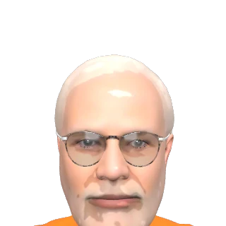
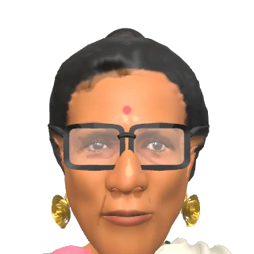
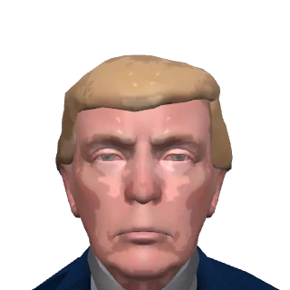
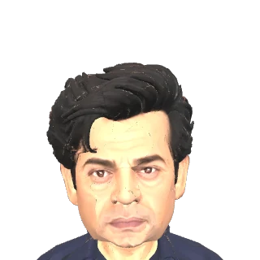
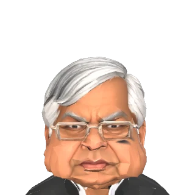
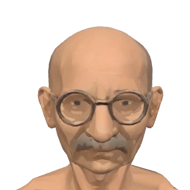

<div align="center">


# 🥊 FIGHTKRO — SANSAD SHOWDOWN
### ⚡ *The Great Desi Kursi Battle in Full 3D* ⚡
**A 3D Political Satire Fighting Game for Web & Android Mobile**

<p align="center">
  <b>👑 9 Iconic Netas</b> &nbsp;•&nbsp; 
  <b>💥 Legendary Specials &amp; Combos</b> &nbsp;•&nbsp; 
  <b>⚡ Real-Time 3D Physics</b> &nbsp;•&nbsp; 
  <b>📱 Signed Android APK</b>
</p>

<p align="center">
  <a href="https://dr-mrbot.github.io/Fightkro/">
    
  </a>
  <a href="https://github.com/Dr-MrBot/Fightkro/releases/download/v1.0.0/FightKro-signed.apk">
    
  </a>
  <a href="https://github.com/Dr-MrBot/Fightkro/releases/tag/v1.0.0">
    
  </a>
  <a href="https://github.com/Dr-MrBot">
    
  </a>
</p>

<p align="center">
  
  
  
  
</p>

---

</div>

## 🌟 Quick Download & Play

| Platform | Download / Launch | Description |
| :--- | :---: | :--- |
| 🌐 **Play Online** | [**🎮 Play on GitHub Pages**](https://dr-mrbot.github.io/Fightkro/) | Instant 3D fighting directly in any web browser without installation. |
| 📱 **Android Mobile** | [**⬇️ Download FightKro-signed.apk**](https://github.com/Dr-MrBot/Fightkro/releases/download/v1.0.0/FightKro-signed.apk) <br> *(or view [Release v1.0.0](https://github.com/Dr-MrBot/Fightkro/releases/tag/v1.0.0))* | Standalone signed APK with offline 3D models, sound effects, adaptive icon, and full-screen immersion. |
| 💻 **PC / Windows** | **Double-click [`PLAY-GAME.bat`](PLAY-GAME.bat)** | Instant one-click local server with zero setup (no XAMPP needed). |
| 🌐 **Local Web** | `http://localhost:8080/` | Run via `python server.py` or `node server.js` or Apache XAMPP. |

---

## 🎮 Game Overview

**FightKro (Sansad Showdown)** is a fast-paced, humorous 3D fighting game celebrating the vibrant spectacle of Indian political satire. Battle across iconic stages, unleash over-the-top special moves, call in Nirmala's Budget, and claim the ultimate Kursi!

### ✨ Key Features

- 🥊 **Full 3D Real-Time Physics & Animation**: Powered by Three.js with Draco-compressed 3D caricatures, dynamic shadows, and comic visual fx.
- 🎙️ **Live Newsdesk & Ticker Commentary**: Real-time breaking news updates from *Breaking Bakwas* and *Troll Army* reacting to every punch, combo, and blunder.
- ⚡ **Shakti Meter & Cinematic Supers**: Fill your Shakti meter to execute devastating character supers with custom animated cutscenes.
- 🔊 **66+ Desi Soundtracks & Voiceovers**: Authentic satirical dialogues, stadium cheers, chai cups shattering, and vegetable vendor shouts.
- 📱 **Mobile Native Experience**: Virtual joystick, touch buttons, and responsive landscape scaling.
- 🌐 **Peer-to-Peer Multiplayer**: Built-in WebRTC room matchmaker to challenge friends across the web.

---

## 👥 Fighter Roster

<div align="center">

| Neta | Style | Archetype | Super / Signature Move |
| :---: | :---: | :---: | :--- |
| <br>**MitraMan** | 🟠 Saffron Striker | Brawler | **Mitra Chakra** & 56-inch Masterstroke |
| <br>**Yatra Boy** | 🔵 Blue Striker | Speedster | **Mohabbat Punch** & Yatra Marathon Dash |
| <br>**Deedee** | 🟢 Bengal Brawler | Agile Fighter | **Khela Hobe** Storm & Didi Roar |
| <br>**Tariff Taau** | 🔴 Tariff Titan | Heavy Tank | **50% Tariff Crate Barrage** & Wall Smash |
| <br>**Dozer Dada** | 🟠 Bulldozer Justice | Grappler | **Bulldozer Summon** & Strict Order Crush |
| <br>**Toll Man** | 🟡 Highway King | Mid-Range | **Fastag Laser** & Expressway Slam |
| <br>**Sutti Babu** | 🟣 Chai Specialist | Counter | **Karak Chai Throw** & Adhiraj Strike |
| <br>**Rail Raja** | 🟢 Railway Baron | Power | **Kulhad Blast** & Rail Track Sweep |
| <br>**Mbapu (Boss)** | 🟡 Final Boss | Secret Boss | **Non-Violence Portal** & Budget Summon |

</div>

---

## 🕹️ Controls

### ⌨️ Keyboard (PC / Web)

| Action | Primary Keys | Arrow Keys |
| :--- | :---: | :---: |
| **Move / Walk** | <kbd>A</kbd> / <kbd>D</kbd> | <kbd>←</kbd> / <kbd>→</kbd> |
| **Jump** | <kbd>W</kbd> | <kbd>↑</kbd> |
| **Crouch** | <kbd>S</kbd> | <kbd>↓</kbd> |
| **Block** | Hold Back | Hold Back |
| **Punch** | <kbd>J</kbd> | — |
| **Kick** | <kbd>K</kbd> | — |
| **Grab** | <kbd>I</kbd> or <kbd>J</kbd>+<kbd>K</kbd> | — |
| **Super Move** | <kbd>L</kbd> or <kbd>Space</kbd> | (When Shakti is full) |
| **Nirmala's Budget** | <kbd>B</kbd> | (When fighting Boss) |
| **Pause Game** | <kbd>Esc</kbd> | — |

### 📱 Touchscreen (Mobile / Android)
- **Virtual Stick (Left)**: Move, jump, crouch, and block.
- **Action Buttons (Right)**: PUNCH, KICK, GRAB, SUPER.

---

## 🚀 How to Run Locally

### Option 1: 1-Click Launch (Recommended for Windows)
Simply double-click **[`PLAY-GAME.bat`](PLAY-GAME.bat)** in the root folder. It starts an optimized server and opens your browser automatically!

### Option 2: Python Server
```bash
python server.py
# Automatically opens http://localhost:8080/
```

### Option 3: Node.js Server
```bash
node server.js
# Automatically opens http://localhost:8080/
```

### Option 4: Apache / XAMPP
Place the project in `htdocs/dashboard/fightkro/` and access it via `http://localhost/dashboard/fightkro/`. The included [`.htaccess`](.htaccess) automatically configures the appropriate MIME types for `.glb` and `.wasm`.

---

## 📱 Android APK Installation

1. Download [**`FightKro-signed.apk`**](https://github.com/Dr-MrBot/Fightkro/releases/download/v1.0.0/FightKro-signed.apk) from the [Official Release Page](https://github.com/Dr-MrBot/Fightkro/releases/tag/v1.0.0).
2. On your Android phone, tap the downloaded `.apk` file and select **Install** (allow "Install unknown apps" if prompted).
3. Tap **Open** to enjoy smooth 60 FPS 3D fighting!

---

## ☕ Support the Project

If you enjoyed playing FightKro and want to support ongoing updates:

<div align="center">


<p><b>Pay via UPI:</b> <code>uppolice70@naviaxis</code></p>
<p><i>Supports GPay · PhonePe · Paytm · BHIM · Navi · Cred</i></p>

</div>

---

## 🛠️ Technology Stack

- **3D Graphics Engine**: [Three.js](https://threejs.org/) + Google Draco 3D Geometry Compression
- **Audio Engine**: Web Audio API with spatial audio effects
- **Networking**: WebRTC Peer Connection + Data Channels
- **Android Port**: Hardware-accelerated native Android Activity with immersive sticky fullscreen and embedded asset streaming
- **Signer**: Verified Android APK Signature Scheme v2

---

## ⚖️ Disclaimer

*FightKro (Sansad Showdown)* is an independent work of political satire, parody, and entertainment protected under creative expression laws. Characters and events depicted are fictional, exaggerated caricatures created solely for humor and parody. This game is not affiliated with, endorsed by, or sponsored by any political party, leader, or government entity.

---

<div align="center">

### 👨‍💻 Developed & Maintained by **[Dr-MrBot](https://github.com/Dr-MrBot)**

[](https://github.com/Dr-MrBot)

*Star ⭐ this repository if you enjoyed the showdown!*

</div>
